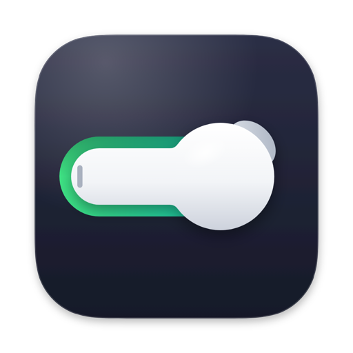

<p align="center">
  
</p>

<h1 align="center">BudSwitch</h1>

<p align="center">A menu bar app that moves your headphones between your Mac and your iPhone.</p>

## Install

```sh
brew install --cask equimper/tap/budswitch
```

Or download the zip from [the latest release](https://github.com/EQuimper/BudSwitch/releases/latest), unzip it and move BudSwitch to Applications. It's signed with a Developer ID and notarized by Apple, and runs on macOS 14 or later, on Apple silicon and Intel.

On first launch, macOS asks for Bluetooth access, the only permission BudSwitch uses: the shortcut needs no Accessibility access, and nothing goes over the network.

## Use

Your headphones need to be paired with both the Mac and the iPhone. From BudSwitch's menu bar icon:

- **Mac** connects your headphones to this Mac.
- **iPhone** lets go of them: press play on your iPhone and they move over.
- **⌃⌥⌘B** toggles between the two, from any app.
- **Locking the Mac** lets go of them too, unless the Mac is playing through them. It then checks again every 15 seconds until playback stops, or until you unlock. **Sleep** always lets go.
- **The headphones submenu**, under their name, picks which headphones the menu, the shortcut and the lock rule control. It follows whichever headphones last connected to the Mac.

The menu bar icon dims while the headphones aren't on the Mac. BudSwitch opens at login; **Launch at Login** in its menu turns that off.

## How it works

- **Mac** opens a Bluetooth connection to the headphones with IOBluetooth's `openConnection`, and macOS moves the sound to them by itself.
- **iPhone** closes that connection with `closeConnection`. The headphones stay paired with both devices, so the iPhone can take them when you press play.
- The lock rule asks Core Audio whether any app is running audio on the headphones' output (`kAudioDevicePropertyDeviceIsRunningSomewhere`).
- The shortcut is a Carbon hot key (`RegisterEventHotKey`), and the login item goes through `SMAppService`.

About 350 lines of Swift and AppKit, with no dependencies.

## Limitations

- Tested with Powerbeats Pro and an iPhone. BudSwitch lists every paired Bluetooth audio device and connects or disconnects any of them the same way, but whether pressing play on the iPhone pulls other headphones over depends on the headphones.
- Core Audio says whether an app has the output running, not whether it makes a sound. An app that keeps it running while paused counts as playing, so locking waits for it; sleep still lets go.

## Build from source

```sh
git clone https://github.com/EQuimper/BudSwitch.git
cd BudSwitch
./build.sh
```

`build.sh` builds `build/BudSwitch.app`, installs it in `~/Applications` and launches it. It needs Xcode 16 or later. It signs the app with your Developer ID or Apple Development certificate (`SIGN_IDENTITY` picks another one), so the Bluetooth permission survives rebuilds. Without a certificate, it signs ad hoc and macOS asks again after every build.

The icon's source is `Assets/AppIcon.svg`. `./icon.sh` renders it into `Resources/AppIcon.icns` and `Assets/icon.png`, using Google Chrome.

## License

[MIT](LICENSE). BudSwitch is not affiliated with Apple.
