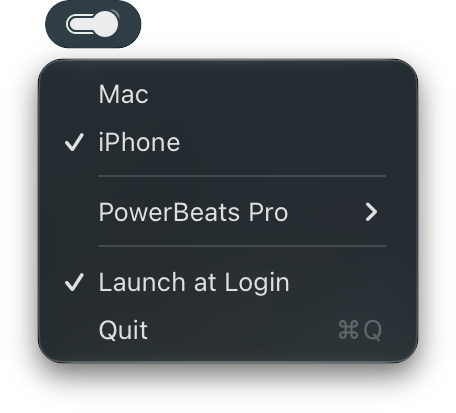

<p align="center">
  
</p>

<h1 align="center">BudSwitch</h1>

<p align="center">A menu bar app that moves your AirPods or Beats between your Mac and your iPhone.</p>

<p align="center">
  
</p>

## Why

Your headphones are paired with your Mac and your iPhone, but they play from one at a time.

You sit down at your Mac and start a video, and the sound comes out of the speakers: your headphones are still on your iPhone. You lock the Mac, head out and press play on a podcast, and it plays out loud from your iPhone: the Mac still has them.

Apple's automatic switching guesses which device you mean. When it guesses wrong, you end up in Bluetooth settings, clicking Connect and waiting.

**BudSwitch doesn't guess. It gives you a switch.** One click, or <kbd>⌃</kbd> <kbd>⌥</kbd> <kbd>⌘</kbd> <kbd>B</kbd> from any app, puts your headphones on your Mac. Another lets go of them, and your iPhone takes them when you press play. Lock your Mac when you leave, and BudSwitch lets go of them for you.

## Install

```sh
brew install --cask equimper/tap/budswitch
```

Or download the zip from [the latest release](https://github.com/EQuimper/BudSwitch/releases/latest), unzip it and move BudSwitch to Applications. It runs on macOS 14 or later, on Apple silicon and Intel.

On first launch, macOS asks for Bluetooth access and for permission to send notifications. The shortcut needs no Accessibility access.

BudSwitch checks GitHub for a new version once a day and sends a notification when there is one. Install it with `brew upgrade equimper/tap/budswitch`, or download the new zip. That check is BudSwitch's only network request, and turning off its notifications in System Settings stops it.

## Use

<p align="center">
  
</p>

Your headphones need to be paired with both your Mac and your iPhone.

| When you… | BudSwitch… |
| --- | --- |
| click **Mac** | connects your headphones to this Mac |
| click **iPhone** | lets go of them, so your iPhone takes them when you press play |
| press <kbd>⌃</kbd> <kbd>⌥</kbd> <kbd>⌘</kbd> <kbd>B</kbd> | toggles between the two, from any app |
| lock your Mac | lets go of them once nothing plays through them |
| put your Mac to sleep | always lets go of them |

The submenu under your headphones' name picks which ones the menu, the shortcut and the lock rule control. It follows whichever headphones last connected to the Mac.

The menu bar icon dims while your headphones aren't on the Mac. BudSwitch opens at login; **Launch at Login** in its menu turns that off.

## Limitations

- Tested with AirPods, Powerbeats Pro and an iPhone. BudSwitch lists every paired Bluetooth audio device and connects or disconnects any of them the same way, but whether pressing play on the iPhone pulls other headphones over depends on the headphones.
- BudSwitch can tell whether an app has your headphones' output running, not whether it makes a sound. An app that keeps it running while paused counts as playing, so locking waits for it; sleep still lets go.

## License

[MIT](LICENSE). BudSwitch is not affiliated with Apple.
